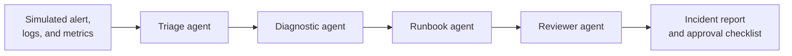

# Multi-Agent Cloud Incident Response Copilot

A local portfolio project that investigates **simulated** cloud incidents through
four specialized LLM agents using Gemini and/or Groq API keys.

The copilot produces an evidence-linked investigation and a proposed runbook. It
does not connect to or change real infrastructure. Any proposed remediation
requires human review.

## Workflow



1. **Triage agent** summarizes the incident and surfaces its signals.
2. **Diagnostic agent** identifies a likely cause and cites the input evidence it
   used.
3. **Runbook agent** suggests cautious investigation and remediation steps.
4. **Reviewer agent** checks the diagnosis and runbook for unsupported claims.
5. The workflow records each agent's input summary, output, status, and order in
   the report's `agent_trace` field.

Each agent makes a separate structured LLM call. The application only analyzes
the supplied incident; it cannot change infrastructure. All recommendations
require human approval.

## Run it (Windows Command Prompt)

Requires Python 3.10 or newer and an API key from Gemini, Groq, or both. Provider
usage may be subject to account quotas or charges.

```cmd
cd /d "C:\Users\METTU SURENDRA REDDY\Desktop\cloud-incident-copilot"
py -3.12 -m venv .venv
call .venv\Scripts\activate.bat
python -m pip install --upgrade pip
python -m pip install -e .
copy .env.example .env
```

Edit `.env` and set `GEMINI_API_KEY`, `GROQ_API_KEY`, or both. Do not paste API
keys into source files or commit `.env`. When both keys are present, Gemini is
tried first and Groq is used if Gemini fails. If only Groq is configured, the
workflow uses Groq directly. Model names can be changed with `GEMINI_MODEL` and
`GROQ_MODEL`.

If a key is accidentally placed in `.env.example`, a source file, or a public
repository, revoke it and create a replacement immediately. Removing a key from
a file or commit does not invalidate it.

List the included scenarios:

```cmd
python -m incident_copilot --list
```

Investigate an incident:

```cmd
python -m incident_copilot --incident incidents/database_pool_saturation.json
```

Launch the local dashboard:

```cmd
python -m streamlit run src\incident_copilot\dashboard.py
```

Choose a scenario and click **Analyze incident** to run the four-agent workflow.
This makes live provider calls; selecting scenarios and viewing/downloading an
existing report do not. The dashboard displays each agent's result and trace and
lets you download the report as JSON.

## Run with Docker

Requires Docker Desktop with Compose. Keep API keys in the local `.env` file;
Compose passes them into the container at runtime, and `.dockerignore` excludes
them from the image build context. Start Docker Desktop and wait for its engine
to be ready before running Compose.

```cmd
if not exist .env copy .env.example .env
notepad .env
docker compose up --build
```

Open `http://localhost:8501`. Stop the service with `Ctrl+C`, then run:

```cmd
docker compose down
```

## Continuous integration

GitHub Actions runs the unit tests, checks Python dependencies, and builds the
Docker image on pushes and pull requests. The workflow does not use or need API
keys; its tests use a fake LLM client.

Print machine-readable JSON:

```cmd
python -m incident_copilot --incident incidents/api_latency.json --format json
```

The JSON report includes the full agent trace. Run the live scenario evaluation
suite (normally four LLM calls per incident, up to twelve for all three cases):

```cmd
python -m incident_copilot.evaluate
```

Save a timestamped JSON report, including the full agent trace, under `reports\`:

```cmd
python -m incident_copilot --incident incidents/database_pool_saturation.json --save-report
```

Generated reports are ignored by Git. Keep real incident details out of public
repositories and use synthetic or sanitized data.

## Test

Unit tests use a fake LLM client and do not make API calls.

```cmd
python -m unittest discover -s tests -v
```

## Included scenarios

- Database connection pool saturation.
- API latency with high CPU utilization.
- An unknown incident that should be escalated for further investigation.

The data is fictional and stored in `incidents/`. Add scenarios there to exercise
the workflow without using production logs or customer data.

Incident data is sent to the configured model provider for analysis. The included
scenarios are fictional; use synthetic or appropriately sanitized data and review
the provider's data-handling terms before using real incident information.

## Project boundaries and next steps

- Provider quotas and pricing depend on your Gemini/Groq account and model.
- If Gemini fails and Groq is configured, fallback can add extra API calls.
- The evaluation suite checks expected causes, cited evidence, human approval,
  and agent trace order against fictional scenarios. It is a starter evaluation,
  not proof of production diagnostic accuracy.
- This project does not deploy to GCP or OCI and does not execute remediations.
- Next: add optional telemetry for model usage.

Never paste real credentials or sensitive production logs into the sample
scenarios or a public repository.
